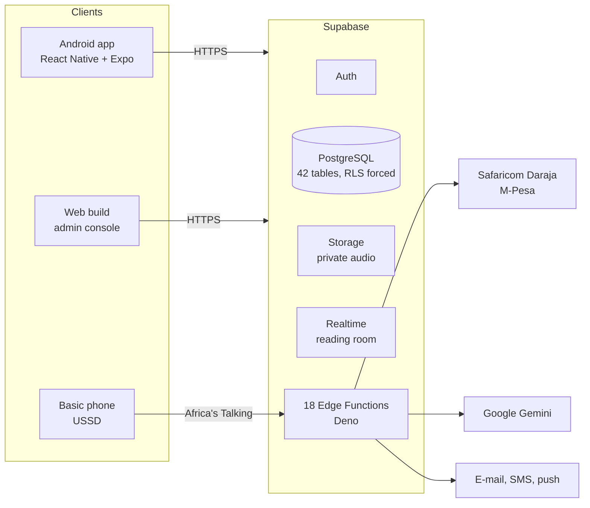

<p align="center">
  <picture>
    <source media="(prefers-color-scheme: dark)" srcset="apps/mobile/assets/images/ilmora-logo-dark.png">
    <source media="(prefers-color-scheme: light)" srcset="apps/mobile/assets/images/ilmora-logo-light.png">
    
  </picture>
</p>

<p align="center">
  <b>The Digital Madrasa Mobile Application.</b><br>
  One platform to run a madrasa and support Quran learning, for owners, teachers, parents and pupils in Kenya.
</p>

<p align="center">
  <a href="https://https-ilmora-expo-app.expo.app"><b>Live web build</b></a>
  &nbsp;·&nbsp;
  <a href="docs/demo-run-sheet.md"><b>Demo guide</b></a>
  &nbsp;·&nbsp;
  <a href="docs/final-year-documentation/Digital_Madrasa_Final_Project_Report.pdf"><b>Project report</b></a>
</p>

<p align="center">
  
  
  
  
  
</p>

## Why it exists

Most madrasas and duksi in Kenya keep attendance, memorisation and fees in exercise books, or not at all. Parents rarely know how their child is doing, and fee payments are not linked to invoices. Quran apps serve individual learners, while school management systems have no Quran-specific features. ILMORA combines both, and keeps every madrasa's records private from every other.

## What it does

| Role | Highlights |
| --- | --- |
| **Owner** | Registers the madrasa, admits pupils (admission numbers are issued by the database), manages classes and staff, issues numbered invoices, approves parent links, sees an impact dashboard |
| **Teacher** | Manual and QR attendance (a code that changes every 30 seconds; registers marked offline sync later), surah-by-surah memorisation, recitation review with a master-reciter comparison, certificates and ijazah with QR verification, a live reading room, a video library |
| **Parent** | Links to a child by admission number, follows attendance and progress, pays fees by M-Pesa, messages the child's teachers, hears a spoken progress report, can sponsor a pupil, or uses USSD on a basic phone |
| **Pupil** | Daily hifz plan (Sabaq, Sabqi, Manzil), recitation recording with AI tajweed feedback when a parent consents, recite-along practice, streaks and badges |
| **Platform admin** | Web console: every madrasa, impact across the platform, and an audit log |

Every screen is available in English, Kiswahili, Somali and Arabic (right to left).

## Architecture



- **The database enforces every rule.** Row Level Security is enabled and forced on all 42 tables (89 policies), so a modified client still cannot read another madrasa's records or act outside its role.
- **Privileged work runs on the server.** Payments, invoicing, AI feedback, notifications and USSD run in Edge Functions; secret keys never ship in the app.
- **Money is derived, never sent.** The app names the invoices to pay; the server computes the amount, and a payment settles exactly once even if Safaricom's callback arrives twice.

## Tech stack

| Layer | Tools |
| --- | --- |
| App | TypeScript, React Native, Expo SDK 54, Expo Router, TanStack Query, Zod, i18next |
| Backend | Supabase: PostgreSQL with Row Level Security, Auth, Storage, Realtime, Edge Functions (Deno) |
| Integrations | Safaricom Daraja (M-Pesa STK push), Google Gemini, Paystack, Africa's Talking (USSD), YouTube embeds |
| Quality | Vitest, SQL verification suites, live check scripts, GitHub Actions |
| Delivery | EAS Build (Android APK), EAS Hosting (web), Supabase CLI |

## Repository layout

```text
apps/mobile/          Expo app: routes per role under app/, components, API client (mock and Supabase)
packages/shared/      Types, validation schemas and pure logic shared by the app and the server
services/ai-gateway/  Optional self-hosted AI gateway
supabase/migrations/  41 numbered migrations: schema, policies, functions, triggers
supabase/functions/   18 Edge Functions (payments, invoices, QR attendance, AI, notifications, USSD...)
supabase/tests/       SQL suites that prove the security guarantees
scripts/              Migration runner, live checks, security report, backups
docs/                 Demo guide, security report, final-year report and guides
```

## Getting started

Requires Node.js 20.19.4 or newer.

```bash
npm install
cp apps/mobile/.env.example apps/mobile/.env   # EXPO_PUBLIC_API_MODE=mock runs on demo data
npm run mobile                                  # Expo dev server; scan with Expo Go or press w for web
```

In **mock** mode the app runs entirely on built-in demo data and needs no backend. To use a real backend, set `EXPO_PUBLIC_API_MODE=supabase` with your project's URL and anon key, copy `supabase/.env.example` to `supabase/.env` for the scripts, and apply the schema with `npm run db:migrate`. Server secrets (M-Pesa, Gemini, messaging) belong in Supabase Edge Function secrets, never in the app's `.env`.

## Quality and security

| Command | What it proves |
| --- | --- |
| `npm test` | 185 unit tests (validation, payments, QR tokens, hifz plan, badges, offline queue...) |
| `npm run typecheck` | Strict TypeScript across every workspace |
| `npm run security:report` | Runs 21 SQL suites against the database and writes a report of the 145 guarantees they prove |
| `npm run check:screens` | Every screen's queries succeed for every role on the live backend |
| `npm run check:i18n` | All four languages are complete |
| `npm run secret-scan` | No server secret has leaked into the app |

## Status

| Area | State |
| --- | --- |
| Accounts, attendance, memorisation, recitations, fees, messaging, reading room, videos, badges, USSD | Working on the live backend |
| M-Pesa | Safaricom Daraja **sandbox**: a real PIN prompt with test money; production needs a registered Paybill or Till |
| Cards, e-mail, SMS | Test providers until live accounts are configured |
| AI tajweed feedback | Provisional and clearly labelled; the teacher's review is final, and nothing is assessed without a parent's consent |
| In-app video | Built but switched off; live lessons use Google Meet or Zoom links |
| Push notifications | Built; needs a Firebase project to deliver |

## Documentation

- [Demo run sheet](docs/demo-run-sheet.md): the order to present every feature, with demo accounts
- [How it works, A to Z](docs/ILMORA%20-%20How%20It%20Works%2C%20A%20to%20Z.docx): a step-by-step guide for every role
- [Security proof](docs/security-report.html): the latest run of the SQL suites
- [USSD setup](docs/ussd-setup.md)
- [Final-year project report](docs/final-year-documentation/Digital_Madrasa_Final_Project_Report.pdf)

## Author

Built by **Mohammednur Sukyan** as a final-year project for the BSc in Computer Science at Umma University, Kenya.

No open-source licence has been applied to this repository yet.
