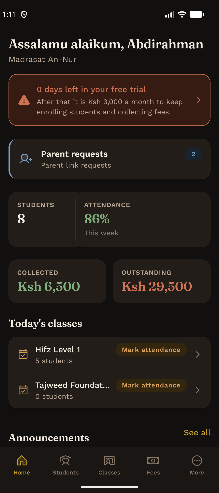
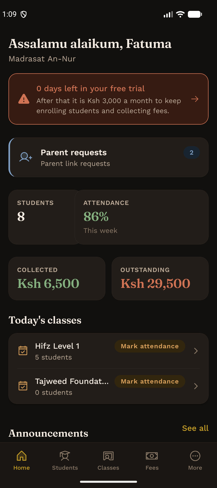
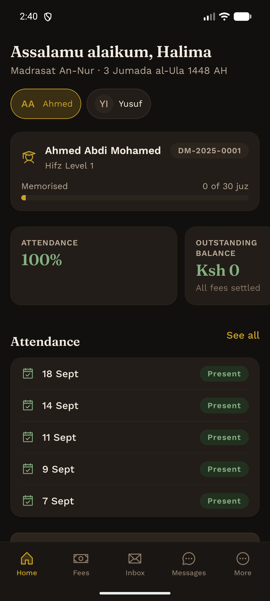
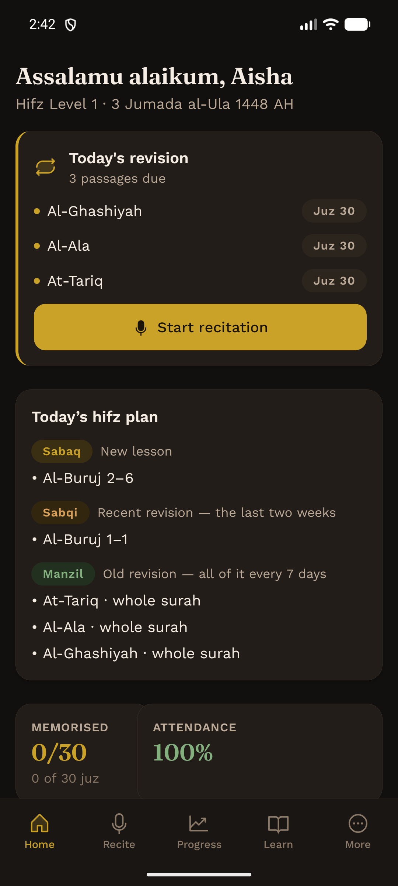
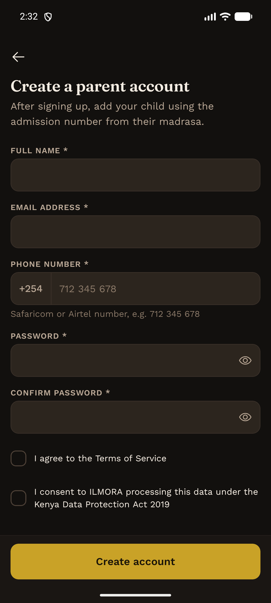
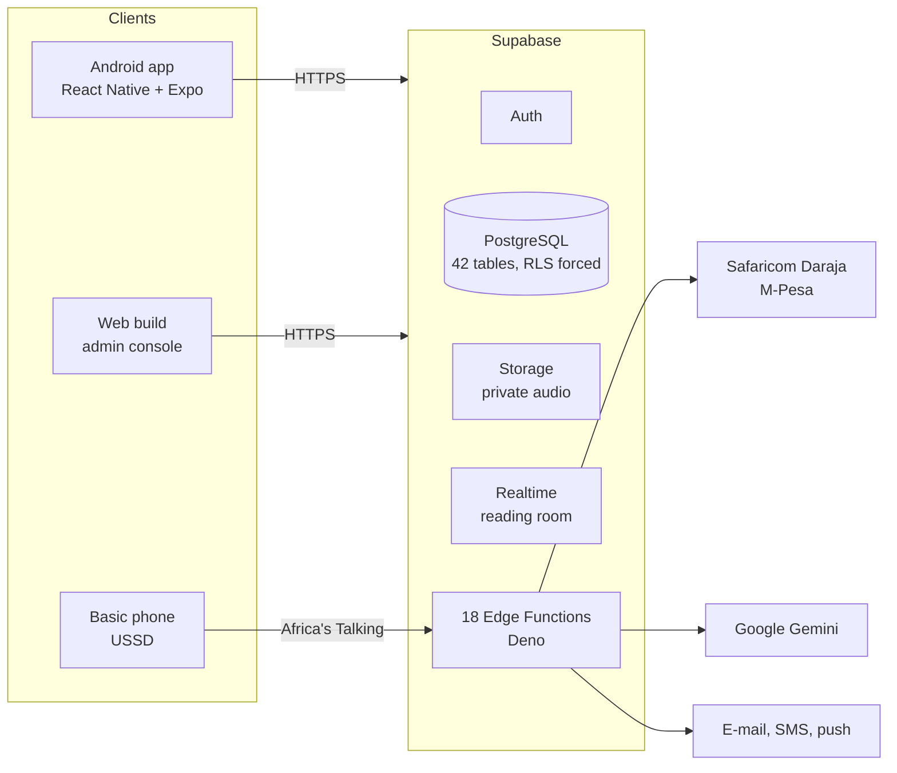

<p align="center">
  <picture>
    <source media="(prefers-color-scheme: dark)" srcset="apps/mobile/assets/images/ilmora-logo-dark.png">
    <source media="(prefers-color-scheme: light)" srcset="apps/mobile/assets/images/ilmora-logo-light.png">
    
  </picture>
</p>

<p align="center">
  A mobile app that helps madrasas in Kenya run their school and support their pupils' Quran learning.
</p>

<p align="center">
  <a href="https://https-ilmora-expo-app.expo.app"><b>Try the web version</b></a>
  &nbsp;·&nbsp;
  <a href="docs/demo-run-sheet.md"><b>Demo guide</b></a>
  &nbsp;·&nbsp;
  <a href="docs/final-year-documentation/Digital_Madrasa_Final_Project_Report.pdf"><b>Project report</b></a>
</p>

<p align="center">
  
  
  
  
  
</p>

## The story behind it

In many madrasas and duksi in Kenya, attendance, memorisation and fees are still written in exercise books, or not written down at all. The owners, teachers and parents I spoke to for this project described the same problems. When a book is lost, a child's history goes with it. Parents usually only find out how their child is doing when they come to pick them up.

There are good Quran apps for individual learners, and there are school management systems, but nothing that does both for a madrasa. So I built ILMORA (the brand name of my final-year project, the *Digital Madrasa Mobile Application*). It's one app where the owner, the teachers, the parents and the pupils each see what they need, and where every madrasa's records stay private.

## What each person can do

**Madrasa owners** register their madrasa, admit pupils (each gets an admission number automatically), set up classes and teachers, send fee invoices, approve parents, and see how the madrasa is doing on an impact dashboard.

**Teachers** take attendance by hand or with a QR code that changes every 30 seconds, and the register still saves when the internet is down. They record memorisation surah by surah, listen to pupils' recordings and compare them with a master reciter, award certificates and ijazah, and run live reading sessions where the whole class follows the same ayah.

**Parents** link to their child using the admission number, then follow attendance, progress and fees. They can pay by M-Pesa, message their child's teacher, listen to a spoken progress report in their own language, and even sponsor another pupil's fees. Parents without a smartphone can check on their children through a USSD menu.

**Pupils** see a daily hifz plan (Sabaq, Sabqi and Manzil), record their recitation for the teacher, practise with recite-along, and earn streaks and badges. The AI only gives tajweed feedback if a parent has agreed to it.

**The platform administrator** uses a web console to look after every madrasa on the system.

The whole app works in English, Kiswahili, Somali and Arabic.

## How it's put together



The app is written in TypeScript with React Native and Expo, and the backend runs on Supabase. A few decisions shaped how I built it:

- **The database protects the data, not the app.** Every one of the 42 tables has Row Level Security, so even a tampered app can't read another madrasa's records or do something its role isn't allowed to.
- **Anything sensitive happens on the server.** Payments, invoices, AI feedback, notifications and USSD run in server functions, and no secret key is ever stored in the app.
- **The phone never decides how much to pay.** The server works out the amount from the invoices, and each payment is only counted once, even if Safaricom confirms it twice.

**Tools I used:** TypeScript, React Native, Expo, Expo Router, TanStack Query, Zod, i18next, Supabase (PostgreSQL, Auth, Storage, Realtime, Edge Functions), Safaricom Daraja, Google Gemini, Africa's Talking, Vitest, GitHub Actions, and EAS for building and hosting.

## Running it on your machine

You'll need Node.js 20.19.4 or newer.

```bash
npm install
cp apps/mobile/.env.example apps/mobile/.env
npm run mobile
```

That starts the app in demo mode, so it runs on sample data and you don't need a backend. Scan the QR code with Expo Go, or press `w` to open it in your browser.

To connect it to a real Supabase project instead, set `EXPO_PUBLIC_API_MODE=supabase` in the `.env` file with your project's URL and anon key, copy `supabase/.env.example` to `supabase/.env`, and run `npm run db:migrate`. Keep the server keys (M-Pesa, Gemini, messaging) in Supabase's function secrets, never in the app's `.env`.

## How I tested it

I wanted to be sure the app is not just working, but safe. These are the checks I run:

- `npm test` runs 185 unit tests, covering things like payments, QR codes, the hifz plan, badges and offline saving.
- `npm run security:report` runs 21 database test suites that try to break the security rules, 145 checks in all, and writes the results to [a report](docs/security-report.html).
- `npm run check:screens` signs in as every role and makes sure each screen loads on the live backend.
- `npm run typecheck`, `npm run check:i18n` and `npm run secret-scan` check the types, the four translations, and that no secret has slipped into the app.

## Where things stand

Most of the app works on the live backend: accounts, attendance, memorisation, recitations, fees, messaging, the reading room, videos, badges and USSD.

A few parts are still in test mode, and I'd rather be clear about them:

- **M-Pesa** runs on Safaricom's sandbox. You get a real PIN prompt, but with test money. Going live needs a registered Paybill or Till number.
- **Card payments, e-mail and SMS** use test providers for now.
- **AI tajweed feedback** is a helper, not a judge. The teacher's review always has the final say.
- **Video inside the app** is built but switched off, so live lessons use Google Meet or Zoom links.
- **Push notifications** are built, but need a Firebase project before they can be delivered.

## More to read

- [Demo guide](docs/demo-run-sheet.md): how I present every feature, with the demo accounts
- [How it works, A to Z](docs/ilmora-how-it-works.docx): a step-by-step guide for each kind of user
- [USSD setup](docs/ussd-setup.md)
- [Final-year project report](docs/final-year-documentation/Digital_Madrasa_Final_Project_Report.pdf)

## How this was built

I designed ILMORA, gathered the requirements from madrasa owners, teachers and parents, made the product and architecture decisions, and tested it on devices and against the live backend. I used Claude (Anthropic) as an AI coding assistant during development, which is why it appears as a co-author on many commits. Every change was reviewed, run and checked by me before it was kept.

## About me

I'm **Mohammednur Sukyan**, a Computer Science student at Umma University in Kenya, and this is my final-year project. If you have feedback or questions, feel free to open an issue.
